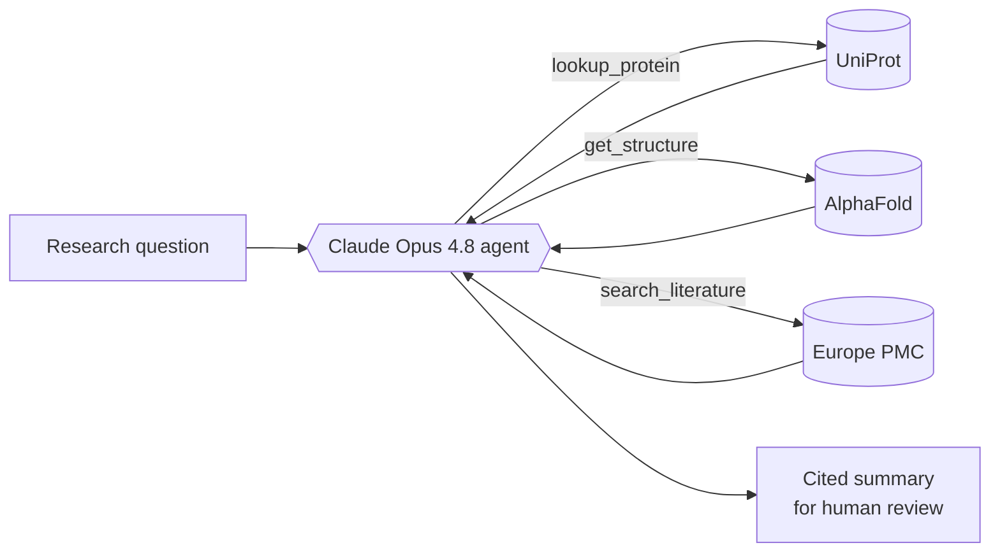

# Autoantigen Discovery Platform

A **disease-agnostic** AI research platform that identifies the self-proteins the immune system
mistakenly attacks in autoimmune disease — summarizing the evidence for each **with citations** and
showing its AlphaFold-predicted 3D structure. Validated first, and most deeply, on **lupus**, then
extended to **rheumatoid arthritis**. A research aide that keeps a human in the loop and takes
nothing on trust.


> *Ro60 (P10155), a classic lupus autoantigen — its AlphaFold structure colored by prediction
> confidence (pLDDT). Mostly very-high confidence (blue), with a low-confidence flexible tail
> (orange).*

### 🔬 Live demos — rotate the real structures in your browser
- **[Lupus — 29 structures](https://dreamcclure.github.io/lupus-autoantigen-assistant/figures/structure_viewer.html)**
- **[Rheumatoid arthritis — 20 structures](https://dreamcclure.github.io/lupus-autoantigen-assistant/figures/rheumatoid_arthritis_viewer.html)**

---

## Why this matters

Researchers spend enormous effort combing the literature and protein databases to work out which
proteins drive an autoimmune disease. This platform speeds that up — and, crucially, **every claim
the agent makes is backed by a citation** to a public database or paper, so a scientist can verify
rather than trust. Because a disease here is just a configuration entry, the same engine extends to
new diseases without rewriting the code.

## Results — validated on two diseases

Each disease's agent was **blind-tested** against a golden set of established autoantigens **plus
negative controls** (abundant proteins that are *not* targets in that disease). The agent is never
told the answers.

| Disease | Autoantigens | Controls | Recall | Precision | Specificity |
|---|---|---|---|---|---|
| **Systemic lupus erythematosus** | 24 | 5 | **0.96** | **1.00** | **1.00** |
| **Rheumatoid arthritis** | 16 | 5 | **0.81** | **1.00** | **1.00** |

**Precision and specificity are perfect on both diseases** — the agent never fabricates a target and
never misclassifies a control. Recall is high, and every miss is a documented, understood
retrieval limitation (not a guess).

**Earned honestly.** Both scores were reached by improving the agent's *evidence and reasoning* while
holding the evaluation rubric fixed — never by lowering the bar (the perfect specificity is the proof).
During the RA work, an early run scored a perfect 1.00 because the agent's instructions had
accidentally *named the answer proteins*; that leak was caught, removed, and the honest result
(0.81) reported instead. The leaked and intermediate runs are preserved in `data/processed/` for
audit.

## How it works

A [LangGraph](https://github.com/langchain-ai/langgraph) agent powered by **Claude Opus 4.8** (with
adaptive thinking) decides which databases to consult, calls its tools, and writes a cited summary.



**Three tools, all free and key-free:** `lookup_protein` (UniProt facts & complex membership),
`get_structure` (AlphaFold 3D structure & pLDDT confidence), `search_literature` (Europe PMC papers).

**Five guardrails, designed in from the start:** (1) cite or don't claim, (2) no hallucination —
answers only from tool results, (3) human in the loop, (4) stay in scope, (5) fail honestly.

**The platform keystone** is `src/diseases.py` — a registry where each disease is pure data (its seed
proteins, its sources, and the reasoning the agent should use). The fetch / build / evaluate scripts
and the agent all read from it, so adding a disease is a *data* change, not a *code* change.

## The data

Every protein is sourced from a peer-reviewed review and **verified live against UniProt**:
- **Lupus** — 24 autoantigens (Ro/La, Sm, U1-RNP, nucleosome, ribosomal P, C1q, Ku, PCNA, β2-GPI) + 5
  controls. Source: [PMC12386345](https://pmc.ncbi.nlm.nih.gov/articles/PMC12386345/).
- **Rheumatoid arthritis** — 16 autoantigens (ACPA targets: vimentin, fibrinogen, enolase, collagen,
  fibronectin, filaggrin, citrullinated histones; plus BiP, RA33, PTX3, and the RF target) + 5
  controls. Source: [PMC11139241](https://pmc.ncbi.nlm.nih.gov/articles/PMC11139241/).

Clean datasets with full provenance live in [`data/processed/`](data/processed/). *(Non-protein
antigens such as dsDNA (lupus) are deliberately out of scope — they have no UniProt/AlphaFold entry.
RA antigens are the citrullinated form; the databases hold the unmodified protein, which is noted.)*

## Run it yourself

```bash
python3 -m pip install -r requirements.txt
cp .env.example .env            # then paste your Anthropic API key into .env

python3 src/fetch_proteins.py  lupus      # download proteins + structures
python3 src/build_dataset.py   lupus      # build the clean dataset
python3 src/evaluate.py        lupus --pilot   # blind evaluation (pilot; drop --pilot for full)
python3 src/agent.py "What is Ro60, and why is it a lupus autoantigen?"

# swap 'lupus' for 'rheumatoid_arthritis' to run the other disease — same engine
```

The biomedical databases need **no API key**; only the agent (Claude) needs an
[Anthropic API key](https://console.anthropic.com).

## Project structure

```
src/
  diseases.py           the platform registry — a disease is just data here
  fetch_proteins.py     fetch proteins + AlphaFold structures (per disease)
  build_dataset.py      validate & build the clean dataset (per disease)
  agent.py              the LangGraph agent + per-disease guardrails
  tools/                the agent's tools (protein, structure, literature)
  evaluate.py           blind evaluation + metrics (per disease)
  build_viewer.py / visualize_structure.py   structure visuals
learn/                  annotated "learning editions" of the code (plain-English teaching)
data/processed/         the cited datasets + evaluation results (per disease)
figures/                structure renders + interactive viewers
```

## Honest limitations

- **Lupus** misses PCNA (1/24); **RA** misses Fibronectin and Histones H4/H2B (3/16) — all literature
  -retrieval gaps where the agent abstained honestly rather than guessing.
- **Filaggrin** (4,061 aa) has no AlphaFold model (too large), so it has no 3D view.
- Scope is **protein** autoantigens with structures; non-protein antigens are excluded by design.
- Negative-control panels are small (5 each); larger panels would tighten the specificity estimates.

## Tech stack

Python · [LangGraph](https://github.com/langchain-ai/langgraph) ·
[Claude Opus 4.8](https://www.anthropic.com) (via `langchain-anthropic`) · UniProt · AlphaFold ·
Europe PMC · matplotlib

## Data sources

UniProt (<https://www.uniprot.org>) · AlphaFold DB (<https://alphafold.ebi.ac.uk>) ·
Europe PMC (<https://europepmc.org>)

## License

MIT — see [LICENSE](LICENSE).
