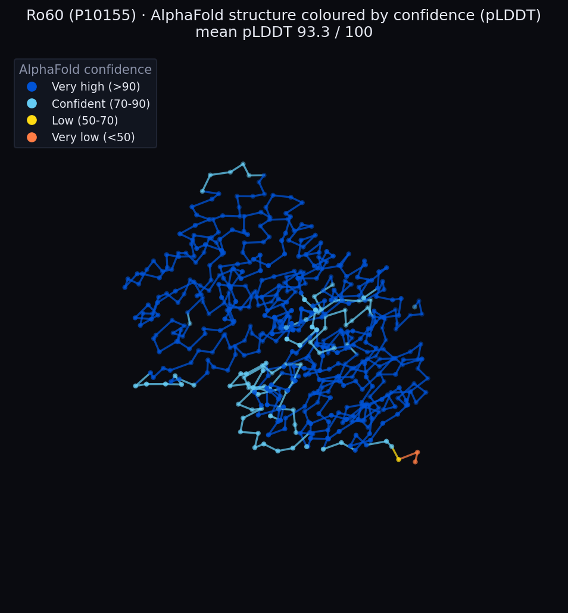
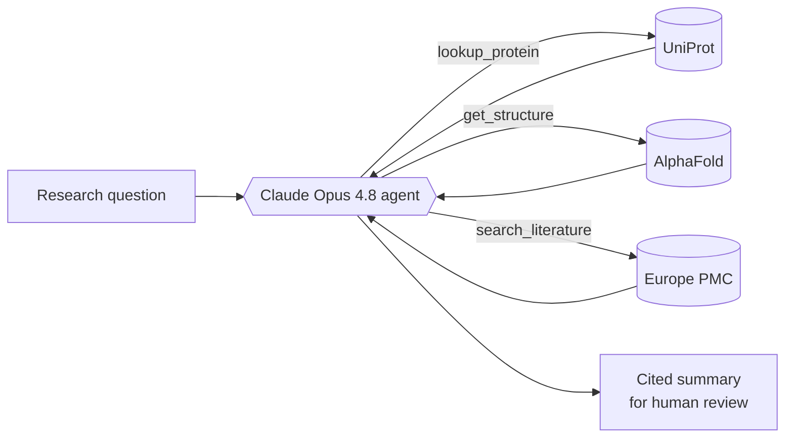

# Lupus Autoantigen Discovery Assistant

An AI research agent that identifies the self-proteins the immune system mistakenly attacks in
**systemic lupus erythematosus (SLE)** — summarizing the evidence for each **with citations** and
showing its AlphaFold-predicted 3D structure. A research aide that keeps a human in the loop and
takes nothing on trust.

### 🔬 [**Live demo → rotate all 29 protein structures in your browser**](https://dreamcclure.github.io/lupus-autoantigen-assistant/figures/structure_viewer.html)



> *Ro60 (P10155), a classic lupus autoantigen — its AlphaFold structure colored by prediction
> confidence (pLDDT). Mostly very-high confidence (blue), with a low-confidence flexible tail
> (orange). Spin all 29 structures in the
> [live interactive viewer](https://dreamcclure.github.io/lupus-autoantigen-assistant/figures/structure_viewer.html).*

---

## Why this matters

Researchers spend enormous effort combing the literature and protein databases to work out which
proteins drive an autoimmune disease. This assistant speeds that up — and, crucially, **every claim
it makes is backed by a citation** to a public database or paper, so a scientist can verify rather
than trust. Lupus is the test case: a disease with high unmet need and exceptionally
well-characterized autoantigens, making it ideal for demonstrating the approach rigorously.

## Results

The agent was **blind-tested** against a golden set of **24 established SLE autoantigens + 5 negative
controls** (abundant proteins that are *not* lupus autoantigens). It was never told the answers.

| Metric | Score | Meaning |
|---|---|---|
| **Precision** | **1.00** | When it says "autoantigen," it is right — zero false positives |
| **Specificity** | **1.00** | All 5 negative controls correctly rejected |
| **Recall** | **0.96** | 23 of 24 real autoantigens identified |

**Iteration, honestly:** an initial run scored **0.67 recall**. The misses were diagnosed (the agent
was missing UniProt's curated *complex-membership* evidence, and had a protein-lookup bug), the
agent's **evidence and tools** were improved — while the evaluation rubric was kept **byte-identical**
— and recall rose to **0.96**. Precision and specificity stayed at **1.00** throughout, which proves
the gain came from better evidence, not a lowered bar. The one remaining miss (PCNA, a rare marker in
older literature) is documented rather than hidden.

```
                 said YES   said NO          (after improvement)
  real autoantigen  23         1
  control (not)      0         5
```

## How it works

A [LangGraph](https://github.com/langchain-ai/langgraph) agent powered by **Claude Opus 4.8** (with
adaptive thinking) decides which databases to consult, calls its tools, and writes a cited summary.



**Three tools, all free and key-free:**
- 🧬 **`lookup_protein`** — protein facts & complex membership from **UniProt**
- 🧊 **`get_structure`** — predicted 3D structure & pLDDT confidence from **AlphaFold**
- 🔎 **`search_literature`** — published papers & citations from **Europe PMC**

**Five guardrails, designed in from the start:**
1. **Cite or don't claim** — no factual statement without the source the tool returned
2. **No hallucination** — answers come only from tool results, never the model's own memory
3. **Human in the loop** — presents findings for a scientist to review; never acts autonomously
4. **Scoped** — stays on lupus-autoantigen research; declines off-topic requests
5. **Fail honestly** — a failed tool call is reported, not papered over with a guess

## The dataset

29 human proteins, each sourced from a 2025 peer-reviewed review
([*Autoantibodies in SLE: Diagnostic and Pathogenic Insights*, PMC12386345](https://pmc.ncbi.nlm.nih.gov/articles/PMC12386345/))
and **verified live against UniProt**: 24 established autoantigens (Ro/La, Sm, U1-RNP, nucleosome,
ribosomal P, C1q, Ku, PCNA, β2-GPI) + 5 negative controls (GAPDH, β-actin, albumin, hemoglobin β,
tubulin β). The clean dataset, with provenance on every field, lives in
[`data/processed/`](data/processed/). *(Non-protein lupus antigens such as dsDNA are deliberately
out of scope — they have no UniProt/AlphaFold entry.)*

## Run it yourself

```bash
python3 -m pip install -r requirements.txt

cp .env.example .env            # then paste your Anthropic API key into .env

python3 src/fetch_proteins.py   # Phase 0 — download proteins + structures
python3 src/build_dataset.py    # Phase 1 — build the clean dataset
python3 src/agent.py "What is Ro60, and why is it a lupus autoantigen?"   # Phase 2 — ask the agent
python3 src/evaluate.py --pilot # Phase 3 — evaluate (pilot; drop --pilot for the full run)
python3 src/build_viewer.py     # (re)build the interactive 3D viewer
```

The biomedical databases need **no API key**. Only the agent (Claude) needs an
[Anthropic API key](https://console.anthropic.com).

## Project structure

```
src/
  fetch_proteins.py     Phase 0 — fetch proteins + AlphaFold structures
  build_dataset.py      Phase 1 — validate & build the clean dataset
  agent.py              Phase 2 — the LangGraph agent + guardrails
  tools/                the agent's tools (protein, structure, literature)
  evaluate.py           Phase 3 — blind evaluation + metrics
  visualize_structure.py / build_viewer.py   structure visuals
data/processed/         the cited dataset + evaluation results
figures/                structure renders + interactive viewer
```

## Honest limitations

- **PCNA** is missed (1 of 24) — anti-PCNA is a rare marker in older literature the search tool
  doesn't surface well. The agent abstains honestly rather than guessing.
- Scope is **protein** autoantigens with structures; non-protein antigens (dsDNA, cardiolipin) are
  excluded by design.
- The negative-control set is small (5); a larger control panel would tighten the specificity
  estimate.

## Tech stack

Python · [LangGraph](https://github.com/langchain-ai/langgraph) ·
[Claude Opus 4.8](https://www.anthropic.com) (via `langchain-anthropic`) · UniProt · AlphaFold ·
Europe PMC · matplotlib

## Data sources

- **UniProt** — <https://www.uniprot.org>
- **AlphaFold Protein Structure Database** — <https://alphafold.ebi.ac.uk>
- **Europe PMC** — <https://europepmc.org>

## License

MIT — see [LICENSE](LICENSE).
